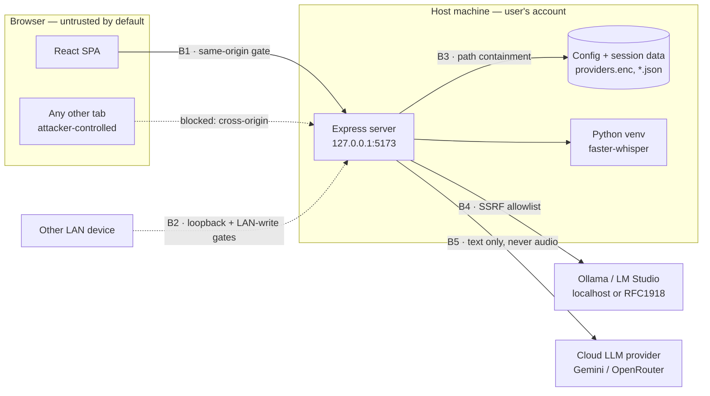
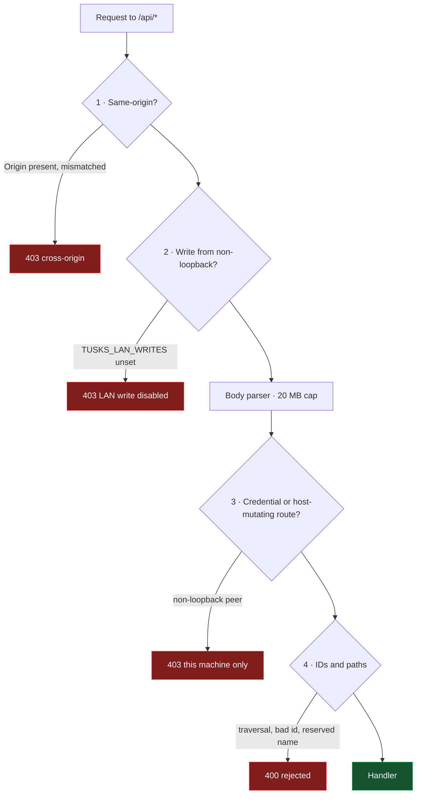

# Security architecture

> **Audience.** This document is for reviewers who want to know *why* Tusk's Tomes is
> built the way it is, not how to use it. For the user-facing policy — what's covered and
> how to report a vulnerability — see [SECURITY.md](SECURITY.md). For the plain-English
> version, see [docs/security/overview.md](../docs/security/overview.md).
>
> **Every claim here cites the code that implements it.** Where a control is weaker than
> it sounds, this document says so rather than letting the reader assume otherwise.

Tusk's Tomes is a local-first desktop application: a React SPA and an Express server on
one loopback port, turning D&D session transcripts into narrative chronicles through an
LLM pipeline. There is no account system, no server we operate, and no telemetry.

That shape determines the entire threat model. Most of what a web application spends its
security budget on — authentication, session management, tenant isolation, per-principal
rate limiting — has no meaning here, because there is exactly one principal and they
already own the machine. The risks that *remain* are narrow and specific, and this
document is about those.

---

## 1. Trust boundaries

Five boundaries matter. Everything inside the host is a single trust domain — the user's
own account — so the interesting questions are all about what crosses an edge.



| # | Boundary | What crosses it | Enforced by |
|---|---|---|---|
| **B1** | Browser → Express | Every API call | Same-origin gate on `/api/*` — [server/index.ts](../server/index.ts) |
| **B2** | LAN → Express | Reads always; writes only on opt-in; credentials never | [`loopbackOnly()`](../server/platform/loopbackGate.ts), [`lanWriteGate()`](../server/platform/lanWriteGate.ts) |
| **B3** | Express → disk | Campaign names, run IDs, session IDs, doc slugs | [server/platform/validators.ts](../server/platform/validators.ts) |
| **B4** | Express → local runner | A user-supplied base URL | [`validateLocalBaseUrl()`](../server/platform/validators.ts) |
| **B5** | Express → cloud LLM | Transcript text and prompts — **never audio** | Provider layer; audio is transcribed in-process |

The one boundary that is *not* a security control is B5. Sending your transcript to a
provider is the thing you configured the provider to do. Tomes protects your key from
other software on your machine; it cannot protect your text from the recipient you chose.

---

## 2. Defence in depth — the request gauntlet

A state-changing request from another device crosses four independent checks before
reaching a handler. Independence is the point: each fails closed on its own, and none of
them relaxes another.



Two details there are deliberate decisions rather than incidental ordering, and both are
covered below: the body parser sits **after** the first two gates (ADR-06), and
`TUSKS_LAN_WRITES=1` does **not** unlock the `loopbackOnly()` routes (ADR-02).

---

## 3. Decision records

Each entry is the reasoning as it was actually made: the threat, the options weighed, the
choice, and what that choice leaves on the table.

### ADR-01 — The TCP peer is the trust signal, not the `Host` header

**Context.** `GET /api/provider-keys` returns the *decrypted* key bundle so the SPA can
reach providers directly. It must be reachable from the user's own browser and from
nowhere else — including when the user has deliberately set `TUSKS_HOST=0.0.0.0`.

**Threat.** A device on the LAN sends `Host: localhost` and collects the user's API keys.

**Options.**

- *Trust the `Host` header* — rejected. Entirely client-controlled; this is the bug being
  defended against, not a defence.
- *Trust the `Origin` header* — rejected as the sole check. Absent on non-browser callers
  (curl, the smoke test), so it either breaks legitimate tooling or fails open.
- *Trust the TCP peer address* — chosen.

**Decision.** [`isLoopbackSource()`](../server/platform/loopbackGate.ts) reads
`req.socket.remoteAddress`, the address the kernel accepted the connection from. Spoofing
it requires control of routing between the two hosts, not a header edit.

**Accepted.** Correctness now depends on enumerating loopback's spellings —
`127.0.0.0/8`, `::1`, and the IPv4-mapped `::ffff:127.*` forms that appear on dual-stack
listeners. A gap in that list is a bypass, which is why the predicate is pure, exported,
and unit-tested independently of the middleware that wraps it.

### ADR-02 — LAN exposure splits reads from writes, and writes fail closed

**Context.** The requested feature is "read my chronicles from the tablet on the sofa."
The implementation people reach for is binding to `0.0.0.0`.

**Threat.** That bind is one environment variable, and it is not always set on the network
the user pictured. On an untrusted network it hands every state-changing route to whoever
is present.

**Options.**

- *All-or-nothing LAN access* — rejected. Grants write access to satisfy a read use case.
- *Add authentication* — rejected. Credentials, reset flows and secure storage are a
  large, permanently-maintained surface, added to a single-user hobbyist application, to
  solve a problem that correct scoping solves for free.
- *Split on the HTTP verb* — chosen.

**Decision.** [`lanWriteGate()`](../server/platform/lanWriteGate.ts) passes `GET`/`HEAD`/`OPTIONS`
from anywhere, passes everything from loopback, and returns 403 for a non-loopback write
unless `TUSKS_LAN_WRITES=1`. [`parseLanWritesEnv()`](../server/platform/lanWriteGate.ts) treats
unset — and any unrecognised value — as false. The accidental coffee-shop bind yields a
read-only browser, not an open control panel.

**The layer that matters most is the one this doesn't touch.** Setting
`TUSKS_LAN_WRITES=1` does not unlock the `loopbackOnly()` routes. Credentials, the
updater, the process launcher and diagnostics stay same-machine-only regardless. A user
enabling a convenience feature cannot thereby disable a credential boundary, because the
two are separate controls rather than two settings of one control.

### ADR-03 — Guards live where the path is built, not where the route is declared

**Context.** Session IDs and run IDs arrive as URL parameters and end up inside
`path.join()`.

**Threat.** The obvious fix is validating at each route. The obvious fix decays: someone
adds a seventh route six months later and doesn't know the rule exists.

**Decision.** Validation is asserted at the *definition* of every function that composes
an ID into a path — [`assertValidSessionId()`](../server/platform/validators.ts) inside
`sessionDir()`, `assertValidRunId()` inside the checkpoint path builder. A future caller
who forgets the route-level guard still cannot traverse, because the traversal is refused
where the filesystem path is actually constructed.

**Why this is architecture rather than a lint rule.** It changes the default. Route-level
validation makes safety something each contributor must remember; definition-level
assertion makes it something they would have to actively remove. The route guards remain —
[`rejectInvalidId()`](../server/platform/validators.ts) returns a clean 400 instead of a thrown
500 — but they are the ergonomics layer, not the security layer.

`ID_RE` is `/^[a-zA-Z0-9_-]{1,64}$/` — an allowlist of permitted characters rather than an
attempt to enumerate dangerous ones. It admits UUIDv4 and nanoid while rejecting `.`, `/`,
`\`, `..`, null bytes and percent-encoding without having to anticipate each one
individually.

### ADR-04 — The SSRF allowlist validates the resolved address, not the string

**Context.** Browsers cannot reach `localhost:11434` from an app served on port 5173 —
different origin. Express proxies it. A proxy that forwards user-supplied URLs is an
open-proxy gadget unless the allowlist is genuinely tight.

**Threat.** Three distinct bypass classes, all real:

1. **Alternate IP encodings.** `0x7f.0.0.1`, `2130706433` and `017700000001` all reach
   loopback. A naive `startsWith('127.')` sees none of them.
2. **Userinfo confusion.** In `http://1.2.3.4@127.0.0.1/` the host is `127.0.0.1`, but
   sloppy parsing reads `1.2.3.4`.
3. **A hostname that resolves outward.** `evil.example.com` pointed at a public IP, or at
   the cloud metadata endpoint `169.254.169.254`.

**Decision.** [`validateLocalBaseUrl()`](../server/platform/validators.ts) rejects non-`http(s)`
schemes, rejects any URL carrying userinfo, matches IPv4 against a strict dotted-decimal
regex so hex, octal and decimal-integer forms fail to parse as IPv4 at all, handles IPv6
including the IPv4-mapped `::ffff:` form, and — when the host is a name rather than a
literal — resolves it and applies the same private-address test to the **answer**.

Cloud metadata endpoints need no special-case entry: `169.254.169.254` is not in any
private range the allowlist admits, so the general rule refuses it. An allowlist that
handles a known attack without naming it is more likely to handle the next one.

**Accepted, and stated at the function.** A TOCTOU window remains between validation and
fetch — DNS rebinding could re-point a name after the check. The 60-second lookup cache
narrows it and the proxy's blast radius is limited to local-LLM traffic, but closing it
properly means pinning to the resolved IP at fetch time. That limitation is documented in
the source rather than left for a reader to discover.

### ADR-05 — The keystore is machine-bound obfuscation, and says so out loud

**Context.** Provider API keys must not sit in plaintext on disk.

**Decision.** AES-256-GCM, key derived by scrypt over `hostname::username::platform` and
salted per-machine — [server/features/providers/services/crypto/keyStore.ts](../server/features/providers/services/crypto/keyStore.ts). Writes are
atomic (temp file, then rename) so a crash mid-save cannot leave a partially-written file
behind.

**What it actually defends against.** `providers.enc` leaving the machine — a synced cloud
folder, a backup, a shared drive, a support bundle, a repository someone accidentally
commits it to. In each of those the ciphertext lands somewhere the derivation inputs do
not.

**What it explicitly does not defend against.** An attacker executing code as the user on
that machine. They derive the same key, because every input is available to them.

**Options weighed.** A user-supplied master password would raise that bar. Rejected: it
defends against an attacker who by construction is already running as the user and could
keylog the password anyway, while guaranteeing that some proportion of a hobbyist user
base permanently loses access to keys they had already paid for. The protection is
speculative; the support burden is certain.

**The honesty is part of the control.** The file header calls it *"OBFUSCATION, not
high-grade cryptography"* and SECURITY.md repeats it. A user who believes their keystore
is unbreakable makes worse decisions after a machine compromise than one who knows to go
and rotate. Overstating a control is itself a vulnerability, because it mis-calibrates the
person relying on it.

### ADR-06 — Rejection happens before parsing

**Decision.** The same-origin and LAN-write gates are mounted *before*
`express.json({ limit: '20mb' })` — [server/index.ts](../server/index.ts).

**Why.** Parsing first means a request that is about to be refused still costs up to 20 MB
of JSON deserialisation. Cheap checks precede expensive work, so the cost of a rejected
request stays proportional to rejecting it.

### ADR-07 — Raw HTML is expanded and *then* pruned, in that order

**Context.** The Help tab renders repository markdown, which uses inline HTML for badges
and `<details>` blocks, so raw HTML cannot simply be switched off.

**Decision.** `rehypeRaw` then `rehypeSanitize`, in that sequence —
[src/features/help/components/DocsViewer.tsx](../src/features/help/components/DocsViewer.tsx). Raw HTML becomes AST
nodes first; the sanitiser then prunes everything outside the allowlisted schema.

**Why the order is load-bearing.** Reversed, the sanitiser runs over markdown whose HTML
is still an opaque string, passes it through untouched, and `rehypeRaw` then expands
whatever it contained into live nodes. The pipeline would look correct and sanitise
nothing. The constraint is recorded in a comment at the call site because it is invisible
in the code itself.

### ADR-08 — The Obsidian module is gated at the mount, not at the route

**Context.** The Obsidian vault module reads a user-nominated vault as a lore-grounding
source. It ships enabled rather than requiring installation.

**Threat.** `POST /api/obsidian/config` accepts an arbitrary absolute path. Mounted
ungated under `TUSKS_HOST=0.0.0.0`, that is arbitrary file read for anyone on the network.

**Decision.** The entire router is mounted behind `loopbackOnly()` —
[server/features/lore/routes/obsidian.ts](../server/features/lore/routes/obsidian.ts) — not
just the route that takes a path. Every route on it reads or mutates host state, so the
boundary belongs at the mount, where a newly-added route cannot miss it.

---

## 4. Explicit non-goals

Naming what a system does not defend is part of specifying what it does. Each of these is
a decision, not an omission.

| Non-goal | Why |
|---|---|
| **Authentication and authorisation** | One principal, who owns the machine. No second identity to authenticate, and no privilege level to escalate from or to. |
| **Repudiation controls / audit logging** | STRIDE's R has no content without an auth boundary to repudiate within. Logging the sole user's actions back to themselves protects nobody. |
| **Multi-tenancy or shared-host isolation** | Data separation relies on OS file permissions. Two people on one machine share whichever account runs the server. |
| **Public-internet hardening** | No TLS termination, no auth, no request quotas, no abuse controls. Tomes on a public IP is outside the design. The defaults resist getting there by accident; they do not make it safe on purpose. |
| **Defence against a compromised host** | Malware running as the user reads the config directory, derives the keystore key, and reads decrypted keys from process memory. The correct response is rotation, which SECURITY.md tells the user to perform. |
| **Defence against your chosen LLM provider** | Configuring a provider *is* the decision to send it your text. Tomes protects the key from other local software, not the transcript from its recipient. |
| **Prompt-injection resistance in transcript content** | A transcript is untrusted input to a model, and the model is the trust boundary. Chronicle output is treated as untrusted text throughout and should be read before being shared. |
| **Telemetry, analytics, crash reporting** | Deliberately absent, permanently. Any phone-home endpoint would reveal install counts, IP addresses and usage patterns to whoever controls it — or whoever compromises it. The absence is a feature with a maintenance rule attached. |

---

## 5. Residual risk

Known, accepted, and not fixable in application code:

- **The keystore falls to local code execution** (ADR-05). Mitigation is operational:
  rotate keys after any suspected compromise.
- **A DNS-rebinding TOCTOU window** exists in the local-LLM proxy (ADR-04). Narrowed by
  caching, not closed.
- **`TUSKS_HOST=0.0.0.0` on a hostile network** exposes read access to chronicles and
  transcripts by design. Writes and credentials stay gated; the reads are the feature.
- **The Whisper virtual environment carries the user's filesystem permissions.** Tampering
  with it, or installing unpinned packages into it, is equivalent to running code as the
  user. The pinned `requirements.txt` is the trust boundary.
- **Supply chain.** Dependencies are pinned and CI runs on every change, but a compromised
  upstream package is not something this application can independently detect.

---

## 6. Verifying any of this

Nothing above needs to be taken on trust:

```sh
npm run typecheck      # both client and server
npm test               # vitest — includes the gate and validator suites
npm run smoke-test     # live provider reachability (needs a configured key)
```

The security tests are worth reading on their own, because each encodes the threat rather
than the implementation: [`lanWriteGate.test.ts`](../server/platform/lanWriteGate.test.ts) for
the read/write split, [`providerKeys.test.ts`](../server/features/providers/routes/providerKeys.test.ts) for the
loopback predicate and the routes that depend on it,
[`validators.test.ts`](../server/platform/validators.test.ts) for traversal and SSRF, and
[`keyStore.test.ts`](../server/features/providers/services/crypto/keyStore.test.ts), whose machine-binding case asserts
the property the whole design rests on.
